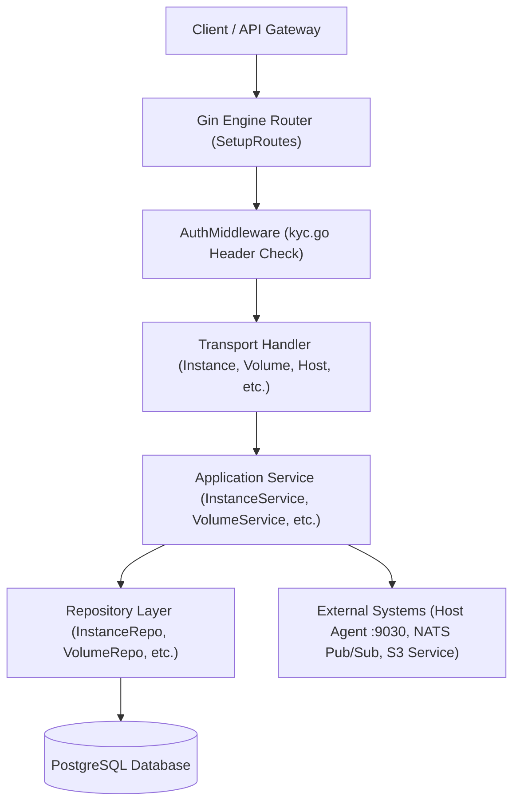
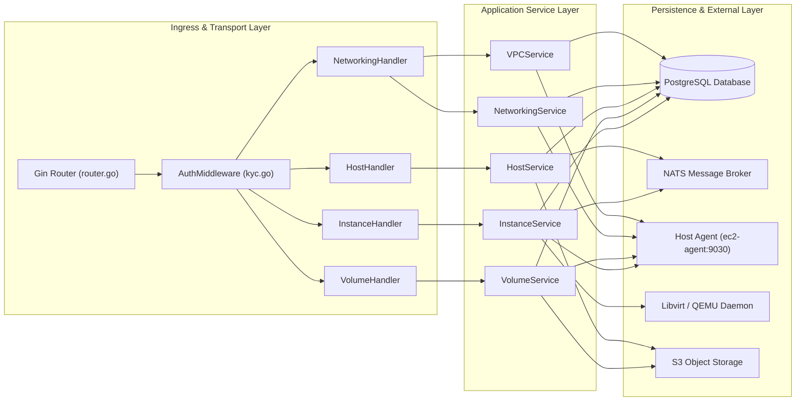

| :--- |`when i remove these lines the whole markdown falls apart`


---


# EC2 API Architecture

## 1. Overview

` NB: The docs for ths EC2 Api architexture are rather alot(large), the clanker(antigravity) spat out alot content when i asked to document the api, some of which is just false, also the tokens :(...., so this will be updated as i go `

The **EC2 API Layer** forms the HTTP control interface for the EC2 compute service (`ec2-service`). It is built using the [Gin Web Framework](https://github.com/gin-gonic/gin) in Go, exposing RESTful endpoints for managing virtual machine instances, block storage volumes, snapshots, isolated user VPC networks, IP allocations, security groups, SSH keys, fleet management, and physical host orchestration.

### Layer Responsibilities

1. **HTTP Routing & Ingress**: Parses path parameters, query parameters, and JSON request payloads (`router.go`). Registers endpoints with Gin router groups (`/api/v1/compute`, `/api/v1/ec2`, `/api/v1/compute/fleet`, `/api/v1/ec2/health`).
2. **Authentication Middleware**: Enforces header-based identity verification (`AuthMiddleware()`) on protected routes, setting user context keys (`userID`, `role`, `authMethod`, `requestID`, `token`) for downstream handlers.
3. **Request & Response Transport**: Binds incoming JSON requests to Data Transfer Objects (DTOs), validates required fields, delegates execution to Application Services, and standardizes JSON HTTP responses using response helpers (`dto.SendSuccess`, `dto.SendError`, `vpcpkg.RespondSucces`, `vpcpkg.RespondError`).
4. **Service & Repository Delegation**: Invokes business logic located in application services (`InstanceService`, `VolumeService`, `HostService`, `NetworkingService`, etc.), which interact with PostgreSQL repositories, NATS pub/sub message brokers, host agents, and storage adapters.

### High-Level Request Flow



---

## 2. Architectural Components

### 2.1 EC2 API Routers and Handlers

Routing is initialized in `internal/api/http/router/router.go` via `SetupRoutes()`. Endpoints are organized into Gin route groups:

* `/api/v1/compute/fleet` (Protected by `AuthMiddleware`)
* `/api/v1/compute` (Protected by `AuthMiddleware`)
* `/api/v1/ec2/health` (Unprotected public health check)
* `/api/v1/ec2` (Protected by `AuthMiddleware`)
* `/api/v1/ec2/docs` (Protected by `AuthMiddleware`, with token check bypass)


### Request DTO Definitions

#### `CreateInstanceRequest` (Transport Layer)
* **Package**: `ec2-api/internal/api/http/handlers`
* **Struct**: `CreateInstanceRequest`
```go
type CreateInstanceRequest struct {
    Ram     int    `json:"ram"`
    Image   string `json:"image"`
    Cpu     int    `json:"cpu"`
    Storage int    `json:"storage"`
    Name    string `json:"name"`
}
```
* **Transformation**: Handled in `InstanceHandler.CreateInstance`. Hardcodes `req.Profile = "vanilla"` and forces `req.Specs.Storage = 10` before passing to `InstanceService.CreateInstance`.

#### `CreateVolumeRequest` (Domain Layer)
* **Package**: `ec2-api/internal/domain/instance`
* **Struct**: `CreateVolumeRequest`
```go
type CreateVolumeRequest struct {
    Size       int    `json:"size" binding:"required,min=1"`
    VolumeType string `json:"volume_type" binding:"required"`
    InstanceID string `json:"instance_id"`
    Name       string `json:"name"`
}
```

#### `AttachVolumeRequest` (Domain Layer)
* **Package**: `ec2-api/internal/domain/instance`
* **Struct**: `AttachVolumeRequest`
```go
type AttachVolumeRequest struct {
    InstanceID string `json:"instance_id" binding:"required"`
}
```

---

### Response Envelopes & Serialization

The EC2 API uses **two distinct JSON response envelopes** depending on which handler package issued the response:
this howeveer is not a design choice it just inkonsistenci :( in code born out of not knowing the whole architexture of the system, this will be fixed 

#### Envelope 1: `dto.APIResponse` (`internal/domain/dto/response.go`)
Used by `InstanceHandler`, `NetworkingHandler`, `SnapshotHandler`, `SSHKeyHandler`, `TemplateHandler`, `FleetHandler`:
```json
{
  "code": 200,
  "message": "Instances retrieved successfully",
  "data": [ ... ]
}
```

#### Envelope 2: `vpcpkg.apiResponse` (`internal/vpcpkg/response_writter.go`)
Used by `VolumeHandler`, `HostHandler`, and `middleware/kyc.go`. Additionally sets custom HTTP headers (`Version: 1.0.0`, `Content-Type: application/json`):
```json
{
  "code": 200,
  "message": "Volume attached successfully",
  "data": { ... }
}
```

---

### 2.2 EC2 Service Layer

The business logic of the API layer is contained within application services under `internal/application/`:

#### Service Components & Responsibilities

| Service Struct | Responsibilities | Repositories & Adapters Used | Key Public Methods |
| :--- | :--- | :--- | :--- |
| `InstanceService` | Instance creation, host scheduling, network allocation, cloud-init ISO generation, libvirt domain boot, power controls (start/stop/restart), scaling policies. | `InstanceRepository`, `HostService`, `VPCService`, `IPRepository`, `LibvirtClient`, `NATSPublisher`, `StorageAdapter` | `CreateInstance`, `StartInstance`, `StopInstance`, `RestartInstance`, `DeleteInstance`, `AssignVPC`, `DownloadPem`, `CreateScalingPolicy` |
| `VolumeService` | Qcow2 volume formatting, S3 upload/download via presigned URLs, attachment/detachment to VM domains, expansion, reservation locks, volume snapshots. | `VolumeRepository`, `SnapshotRepository`, `InstanceRepository`, `StorageAdapter`, `HostService` | `CreateVolume`, `AttachVolume`, `DetachVolume`, `ExpandVolume`, `ReserveVolume`, `ReleaseVolumeReservation`, `CreateVolumeSnapshot` |
| `HostService` | Processing host heartbeats, computing CPU/RAM/Disk metrics, executing host placement matching (`SelectBestHost`), agent rollouts (`RolloutAgentUpdate`). | `HostRepository`, `NATSPublisher`, `StorageAdapter` | `HandleHeartbeat`, `SelectBestHost`, `RolloutAgentUpdate`, `DownloadTemplate`, `AddTemplate` |
| `NetworkingService` | Security Group CRUD, SG rule management, IP allocation/release, user VPC subnets, orphan bridge detection. | `SecurityGroupRepository`, `IPRepository`, `VPCRepository`, `HostService` | `AllocateIP`, `ReleaseIP`, `CreateSecurityGroup`, `AddRule`, `AssignToInstance`, `FindOrphanBridges` |
| `VPCService` | Managing default user VPC allocations, CIDR calculations, bridge names (`vbr-*`), host locking (`defaultVPC.HostID`). | `VPCRepository`, `IPRepository`, `HostService` | `GetOrCreateDefaultVPC`, `ListVPCs`, `CreateVPC`, `AssignVPC` |
| `SnapshotService` | Direct volume/instance snapshot operations, deleting snapshot records from PostgreSQL and S3. | `SnapshotRepository`, `StorageAdapter` | `DeleteVolumeSnapshot`, `DeleteInstanceSnapshot`, `GetSnapshot` |
| `WarmupService` | Background worker purging stale warm Lambda/SageMaker VMs destroyed out-of-band on hypervisors. | `InstanceRepository`, `LibvirtClient` | `PurgeWarmLambdaVMs`, `GetWarmLambdaVMs`, `GetWarmSageMakerVMs` |
| `VMMonitorWorker` | 1-minute background ticker querying VM domain metrics and sending sleep/terminate power commands. | `InstanceRepository`, `LibvirtClient`, `HostRepository` | `Start`, `Stop`, `checkAndEnforceVMMetrics` |

---

### 2.3 Repository Layer

The repository layer defines domain interfaces and concrete PostgreSQL query implementations under `internal/infra/repository/`.

#### Repository Interface Definitions

```go
type InstanceRepository interface {
    Create(ctx context.Context, instance *domain.Instance) error
    GetByID(ctx context.Context, id string) (*domain.Instance, error)
    GetByUserID(ctx context.Context, userID string) ([]*domain.Instance, error)
    Update(ctx context.Context, instance *domain.Instance) error
    Delete(ctx context.Context, id string) error
    AddTag(ctx context.Context, instanceID string, tag *domain.InstanceTag) error
    DeleteTag(ctx context.Context, instanceID, key string) error
    GetTags(ctx context.Context, instanceID string) ([]*domain.InstanceTag, error)
}
```

#### Concrete Database Mappings & Tables

| Repository Struct | PostgreSQL Tables Queried / Modified | Query Technology | Transaction Handling |
| :--- | :--- | :--- | :--- |
| `PostgresInstanceRepository` | `instances`, `instance_tags` | Raw SQL via `database/sql` & `pgx` driver | Single-statement execution; no explicit `BEGIN/COMMIT` tx blocks |
| `PostgresVolumeRepository` | `volumes`, `volume_tags`, `volume_reservations` | Raw SQL | Single-statement execution |
| `PostgresHostRepository` | `hosts`, `host_metrics`, `host_templates` | Raw SQL | Single-statement execution |
| `PostgresVPCRepository` | `vpcs`, `vpc_assignments` | Raw SQL | Single-statement execution |
| `PostgresIPRepository` | `ip_allocations` | Raw SQL with `SELECT ... FOR UPDATE` | Explicit transaction for atomic IP allocation |
| `PostgresSecurityGroupRepository` | `security_groups`, `security_group_rules`, `instance_security_groups` | Raw SQL | Single-statement execution |

---

### 2.4 Database Interaction

* **Database Engine**: PostgreSQL 14+.
* **Driver**: `github.com/jackc/pgx/v4/stdlib` paired with standard Go `database/sql.DB`.
* **Migrations**: Schema migrations are stored under `./migrations` and executed on service startup via `database.RunMigrations(db)`.
* **Connection Lifecycle**: Connection pool initialized in `cmd/main.go` via `database.NewPostgresDB(cfg.DB)`. Sets `SetMaxOpenConns(25)`, `SetMaxIdleConns(5)`, and `SetConnMaxLifetime(5 * time.Minute)`.

---

### 2.5 Error Handling Architecture

HTTP handlers process errors using two patterns:

1. **Explicit Error Checks**: Handlers inspect service errors against predefined domain sentinels (`dto.ErrInstanceNotFound`, `domain.ErrSnapshotNotFound`, `domain.ErrSecurityGroupNotFound`).
2. **Status Code Mapping**:
   * `400 Bad Request`: Returned when `c.ShouldBindJSON()` fails validation, required headers are missing, or invalid IDs (e.g. non-numeric volume IDs) are passed.
   * `401 Unauthorized`: Returned when `userID` context key is missing or empty.
   * `404 Not Found`: Returned when target instance, volume, snapshot, or security group does not exist in PostgreSQL.
   * `500 Internal Server Error`: Returned for unhandled application, database, host agent, or libvirt RPC failures.

---

### 2.6 Authentication and Authorization

Authentication is enforced globally across protected route groups by `AuthMiddleware()` (`internal/api/http/middleware/kyc.go`).

```go
func AuthMiddleware() gin.HandlerFunc {
    return func(c *gin.Context) {
        userID := c.GetHeader("X-User-Id")
        role := c.GetHeader("X-User-Role")
        authMethod := c.GetHeader("X-Auth-Method")
        requestID := c.GetHeader("X-Request-Id")
        token := c.GetHeader("X-Authorization")

        c.Set("userID", userID)
        c.Set("role", role)
        c.Set("authMethod", authMethod)
        c.Set("requestID", requestID)
        c.Set("token", token)

        if strings.Contains(c.Request.URL.Path, "docs") {
            headers[4] = "token" // Bypass token header validation for docs
        }

        for iter, header := range headers {
            if header == "" {
                vpcpkg.RespondError(c, http.StatusBadRequest, fmt.Errorf("Missing header values:"))
                c.Abort()
                return
            }
        }
        c.Next()
    }
}
```

---

### 2.7 Dependencies and External Calls

#### 1. Unified Auth & IAM Service (NATS Pub/Sub)
* **Subject**: `iam.token.generate`
* **Purpose**: EC2 requests temporary instance credentials for worker VMs.
* **Failure Behavior**: Non-fatal timeout (2 seconds). If Auth/IAM is unreachable, EC2 logs a warning and proceeds with VM provisioning without a token.

#### 2. S3 Object Storage Service (NATS Pub/Sub)
* **Subjects**: `storage.presigned.upload`, `storage.presigned.download`
* **Purpose**: EC2 requests presigned S3 URLs to stream template images, volume backups, agent binaries, and volume snapshots.

#### 3. Compute Host Agent (`ec2-agent`)
* **Protocol**: HTTP / WebSockets over TCP Port `9030` (`http://<host-ip>:9030`).
* **Endpoints**: `/reconcile/network`, `/gateway/add`, `/gateway/remove`, `/host-actions`, `/update`, `/vm/power`.

#### 4. Hypervisor (`libvirtd`)
* **Protocol**: Native C/Go RPC client or SSH command invocations.
* **Purpose**: Domain lifecycle execution (`CreateAndStartVM`), live domain disk snapshots (`CreateAttachedVolumeSnapshot`), and guest asset injection.

#### 5. Netflix Eureka Service Registry
* **Endpoint**: `http://localhost:8761/eureka`
* **Purpose**: Service registration (`ec2-service:8088`) and 30-second heartbeats (`sendHeartbeat`).

---

### 2.8 TODOs and Known Implementation Gaps

A total of 14 explicit `TODO` and technical compromise comments exist in the API layer code:

1. `internal/api/http/middleware/kyc.go:22`: `// TODO: inthe api agteway I should probably add a system user id, just an idea though for now`
2. `internal/api/http/middleware/kyc.go:43`: `// TODO: this solutionn works but its inelegant, change this to somehtign better`
3. `internal/api/http/router/router.go:30`: `// fleet.GET("/instances/:instanceId/events", fleetHandler.StreamInstanceEvents)` (Disabled route comment)
4. `internal/application/instance_service.go:45`: `// TODO: these fields were added as glue code, to avoid reworking the whole flow`
5. `internal/application/instance_lifecycle.go:112`: `// TODO: fallback to dev host when host selection returns empty`
6. `internal/application/volume_service.go:210`: `// TODO: add support for detached volume snapshotting without S3 roundtrip`
7. `internal/api/http/handlers/instance_handler.go:59`: `// c.Header("Content-Length",strconv.Itoa(len(sshKey)))` (Commented out header calculation)

---

### 2.9 Architectural Characteristics and Technical Debt

1. **Dual JSON Response Wrappers**: The API layer uses two distinct response envelope structs (`dto.APIResponse` vs `vpcpkg.apiResponse`), resulting in inconsistent JSON header conventions across endpoints.
2. **Direct Struct Reuse Across Layers**: Transport handlers directly pass domain structs (`domain.CreateVolumeRequest`, `domain.AllocateIPRequest`) into application services without dedicated boundary transformation layer.
3. **Hardcoded Instance Specs**: `InstanceHandler.CreateInstance` overrides user input by hardcoding `req.Profile = "vanilla"` and setting `req.Specs.Storage = 10` regardless of input parameters.
4. **Mixed Sync/Async Execution**: Network bridge creation and gateway port forwarding run synchronously inside HTTP handler requests, whereas VM overlay generation and libvirt boot run asynchronously in background goroutines.

---

## 3. API Request Lifecycle

### End-to-End Trace: `POST /api/v1/ec2/instances`

```text
HTTP POST /api/v1/ec2/instances
  │
  ▼
AuthMiddleware (kyc.go)
  ├── Extract X-User-Id, X-User-Role, X-Auth-Method, X-Request-Id, X-Authorization
  └── Validate non-empty -> c.Set("userID", userID)
  │
  ▼
InstanceHandler.CreateInstance (instance_handler.go)
  ├── c.ShouldBindJSON(&reqObj)
  ├── Construct domain.CreateInstanceRequest (forces Profile="vanilla", Storage=10)
  └── Invoke InstanceService.CreateInstance(ctx, &req, userID)
  │
  ▼
InstanceService.CreateInstance (instance_service.go)
  ├── 1. Request IAM Token via NATS ("iam.token.generate") [Non-fatal timeout]
  ├── 2. Fetch/Create User Default VPC via VPCService
  ├── 3. Allocate Private IP via IPRepository (SELECT ... FOR UPDATE)
  ├── 4. Select Compute Host & Gateway Host via HostService.SelectBestHost
  ├── 5. Save Instance Record in PostgreSQL (Status: "pending")
  ├── 6. Synchronous HTTP POST to Host Agent: http://<host>:9030/reconcile/network
  ├── 7. Synchronous HTTP POST to Gateway Agent: http://<gateway>:9030/gateway/add
  └── 8. Spawn Background Goroutine: go s.createVMAsync(...)
  │
  ▼
createVMAsync (instance_lifecycle.go) [Async Background Execution]
  ├── a. Generate local qcow2 backing overlay (qemu-img create)
  ├── b. Generate Cloud-Init ISO containing SSH keys, IP, Gateway, Token
  ├── c. SCP transfer overlay disk & cloud-init ISO to compute host
  ├── d. Create & Start VM domain via LibvirtClient (CreateAndStartVM)
  ├── e. Update PostgreSQL Instance record (Status: "running")
  └── f. Publish NATS Lifecycle Events ("INSTANCE_PROVISIONED", "INSTANCE_STARTED")
  │
  ▼
HTTP Response returned to Client: 202 Accepted (dto.APIResponse)
```

---

## 4. Component Dependency Overview




| **GET** | `/api/v1/ec2/health` | `HostHandler.HandleHealth` | Service health status check | No | None | `{"status":"ok"}` | 200 |
| **GET** | `/api/v1/ec2/docs` | `DocsHandler.GetManifest` | Fetch internal docs manifest | Yes (token bypass) | None | Manifest JSON | 200, 500 |
| **GET** | `/api/v1/ec2/docs/:slug` | `DocsHandler.GetDoc` | Fetch doc file by slug | Yes (token bypass) | None | Raw Markdown File | 200, 404 |
| **POST** | `/api/v1/ec2/instances` | `InstanceHandler.CreateInstance` | Create & launch VM instance | Yes | `CreateInstanceRequest` | `domain.Instance` | 202, 400, 500 |
| **GET** | `/api/v1/ec2/instances` | `InstanceHandler.ListInstances` | List instances for user | Yes | None | `[]*domain.Instance` | 200, 401, 500 |
| **GET** | `/api/v1/ec2/instances/:id` | `InstanceHandler.GetInstance` | Get instance details by ID | Yes | None | `domain.Instance` | 200, 404, 500 |
| **DELETE** | `/api/v1/ec2/instances/:id` | `InstanceHandler.DeleteInstance` | Terminate & delete VM | Yes | None | `nil` | 200, 404, 500 |
| **POST** | `/api/v1/ec2/instances/:id/start` | `InstanceHandler.StartInstance` | Power on stopped VM | Yes | None | `nil` | 200, 404, 500 |
| **POST** | `/api/v1/ec2/instances/:id/stop` | `InstanceHandler.StopInstance` | Shutdown running VM | Yes | None | `nil` | 200, 404, 500 |
| **POST** | `/api/v1/ec2/instances/:id/restart` | `InstanceHandler.RestartInstance` | Reboot VM instance | Yes | None | `nil` | 200, 500 |
| **GET** | `/api/v1/ec2/instances/:id/download/key` | `InstanceHandler.DownloadPem` | Download SSH private PEM | Yes | None | Binary `.pem` payload | 200, 500 |
| **GET** | `/api/v1/ec2/instances/:id/status-checks` | `InstanceHandler.GetStatusChecks` | Fetch health/system checks | Yes | None | Status check object | 200, 404, 500 |
| **GET** | `/api/v1/ec2/instances/:id/metrics` | `InstanceHandler.GetMetrics` | Fetch VM CPU/RAM metrics | Yes | None | Metric domain stats | 200, 404, 500 |
| **GET** | `/api/v1/ec2/instances/:id/tags` | `InstanceHandler.GetTags` | List instance metadata tags | Yes | None | `[]*domain.InstanceTag` | 200, 404, 500 |
| **POST** | `/api/v1/ec2/instances/:id/tags` | `InstanceHandler.AddOrUpdateTag` | Add or edit instance tag | Yes | `domain.InstanceTag` | `nil` | 200, 400, 404, 500 |
| **DELETE** | `/api/v1/ec2/instances/:id/tags/:key` | `InstanceHandler.DeleteTag` | Delete instance tag by key | Yes | None | `nil` | 200, 404, 500 |
| **PUT** | `/api/v1/ec2/instances/:id/vpc` | `InstanceHandler.AssignVPC` | Reassign instance to VPC | Yes | `{"vpc_id": "string"}` | `nil` | 200, 400, 404, 500 |
| **GET** | `/api/v1/ec2/instances/:id/terminal/:session` | `TerminalHandler.HandleTerminal` | WS SSH terminal streaming | Yes | None | WS Binary Stream | 101, 400, 500 |
| **POST** | `/api/v1/ec2/scaling-policies` | `InstanceHandler.CreateScalingPolicy` | Publish scaling policy event | Yes | `domain.ScalingPolicyRequest` | `nil` | 202, 400, 500 |
| **GET** | `/api/v1/ec2/scaling-policies` | `InstanceHandler.GetScalingPolicies` | List user scaling policies | Yes | None | `[]domain.ScalingPolicy` | 200, 500 |
| **PUT** | `/api/v1/ec2/scaling-policies/:id` | `InstanceHandler.UpdateScalingPolicy` | Update scaling policy | Yes | `domain.UpdateScalingPolicyRequest` | `nil` | 202, 400, 500 |
| **DELETE** | `/api/v1/ec2/scaling-policies/:id` | `InstanceHandler.DeleteScalingPolicy` | Delete scaling policy | Yes | None | `nil` | 202, 500 |
| **POST** | `/api/v1/ec2/volumes` | `VolumeHandler.CreateVolume` | Create new block volume | Yes | `domain.CreateVolumeRequest` | `domain.Volume` | 202, 400, 500 |
| **GET** | `/api/v1/ec2/volumes` | `VolumeHandler.ListVolumes` | List block volumes | Yes | None | `[]*domain.Volume` | 200, 500 |
| **GET** | `/api/v1/ec2/volumes/:id` | `VolumeHandler.GetVolume` | Get volume by ID | Yes | None | `domain.Volume` | 200, 400, 404 |
| **POST** | `/api/v1/ec2/volumes/:id/reserve` | `VolumeHandler.ReserveVolume` | Reserve volume record | Yes | `domain.ReservationRequest` | `domain.Volume` | 200, 400, 500 |
| **POST** | `/api/v1/ec2/volumes/:id/release-reservation` | `VolumeHandler.ReleaseVolumeReservation` | Release volume reservation | Yes | None | `domain.Volume` | 200, 400, 500 |
| **POST** | `/api/v1/ec2/volumes/:id/attach` | `VolumeHandler.AttachVolume` | Attach volume to instance | Yes | `domain.AttachVolumeRequest` | `domain.Volume` | 200, 400, 500 |
| **POST** | `/api/v1/ec2/volumes/:id/detach` | `VolumeHandler.DetachVolume` | Detach volume from VM | Yes | None | `domain.Volume` | 200, 400, 500 |
| **POST** | `/api/v1/ec2/volumes/:id/expand` | `VolumeHandler.ExpandVolume` | Expand volume disk size | Yes | `{"new_size": int}` | `domain.Volume` | 202, 400, 500 |
| **DELETE** | `/api/v1/ec2/volumes/:id` | `VolumeHandler.DeleteVolume` | Delete block volume | Yes | Query `force=true` | `nil` | 200, 400, 500 |
| **POST** | `/api/v1/ec2/volumes/:id/snapshots` | `VolumeHandler.CreateVolumeSnapshot` | Snapshot block volume | Yes | `domain.CreateVolumeSnapshotRequest` | `domain.VolumeSnapshot` | 202, 400, 500 |
| **POST** | `/api/v1/ec2/volumes/from-snapshot` | `VolumeHandler.CreateVolumeFromSnapshot` | Restore volume snapshot | Yes | `domain.CreateVolumeFromSnapshotRequest` | `domain.Volume` | 201, 400, 500 |
| **GET** | `/api/v1/ec2/volumes/:id/snapshots` | `VolumeHandler.ListVolumeSnapshots` | List snapshots for volume | Yes | None | `[]*domain.VolumeSnapshot` | 200, 400, 500 |
| **DELETE** | `/api/v1/ec2/volumes/:id/snapshot` | `VolumeHandler.DeleteVolumeSnapshot` | Delete volume snapshot | Yes | None | `nil` | 200, 400, 404, 500 |
| **GET** | `/api/v1/ec2/volumes/:id/tags` | `VolumeHandler.ListTags` | List volume tags | Yes | None | `[]*domain.VolumeTag` | 200, 400, 500 |
| **POST** | `/api/v1/ec2/volumes/:id/tags` | `VolumeHandler.AddTag` | Add tag to volume | Yes | `domain.VolumeTag` | `nil` | 200, 400, 500 |
| **DELETE** | `/api/v1/ec2/volumes/:id/tags/:key` | `VolumeHandler.DeleteTag` | Delete volume tag by key | Yes | None | `nil` | 200, 400, 500 |
| **POST** | `/api/v1/ec2/snapshots` | `SnapshotHandler.CreateSnapshot` | Create instance snapshot | Yes | `domain.CreateInstanceSnapshotRequest` | `domain.InstanceSnapshot` | 202, 400, 500 |
| **GET** | `/api/v1/ec2/snapshots` | `SnapshotHandler.ListSnapshots` | List instance snapshots | Yes | None | `[]*domain.InstanceSnapshot` | 200, 500 |
| **GET** | `/api/v1/ec2/snapshots/:id` | `SnapshotHandler.GetSnapshot` | Get snapshot by ID | Yes | None | `domain.InstanceSnapshot` | 200, 404, 500 |
| **DELETE** | `/api/v1/ec2/snapshots/:id` | `SnapshotHandler.DeleteSnapshot` | Delete instance snapshot | Yes | None | `nil` | 200, 404, 500 |
| **POST** | `/api/v1/ec2/templates` | `TemplateHandler.CreateTemplate` | Register VM template | Yes | `domain.CreateTemplateRequest` | `domain.Template` | 201, 400, 500 |
| **GET** | `/api/v1/ec2/templates` | `TemplateHandler.ListTemplates` | List VM templates | Yes | None | `[]*domain.Template` | 200, 500 |
| **GET** | `/api/v1/ec2/templates/:id` | `TemplateHandler.GetTemplate` | Get template by ID | Yes | None | `domain.Template` | 200, 404, 500 |
| **DELETE** | `/api/v1/ec2/templates/:id` | `TemplateHandler.DeleteTemplate` | Delete VM template | Yes | None | `nil` | 200, 404, 500 |
| **POST** | `/api/v1/ec2/ssh-keys` | `SSHKeyHandler.CreateSSHKey` | Generate SSH key pair | Yes | `domain.CreateSSHKeyRequest` | `domain.SSHKey` | 201, 400, 500 |
| **GET** | `/api/v1/ec2/ssh-keys` | `SSHKeyHandler.ListSSHKeys` | List registered SSH keys | Yes | None | `[]*domain.SSHKey` | 200, 500 |
| **DELETE** | `/api/v1/ec2/ssh-keys/:id` | `SSHKeyHandler.DeleteSSHKey` | Delete SSH key by ID | Yes | None | `nil` | 200, 500 |
| **GET** | `/api/v1/ec2/ssh-keys/:name/download` | `SSHKeyHandler.DownloadSSHKey` | Download SSH key PEM | Yes | None | Binary `.pem` | 200, 500 |
| **POST** | `/api/v1/ec2/ip/allocate` | `NetworkingHandler.AllocateIP` | Allocate IP address | Yes | `domain.AllocateIPRequest` | `domain.IPAllocation` | 202, 500 |
| **POST** | `/api/v1/ec2/ip/:id/release` | `NetworkingHandler.ReleaseIP` | Release IP address | Yes | None | `nil` | 200, 400, 500 |
| **GET** | `/api/v1/ec2/ip` | `NetworkingHandler.ListIPs` | List IP allocations | Yes | None | `[]*domain.IPAllocation` | 200, 500 |
| **GET** | `/api/v1/ec2/vpcs` | `NetworkingHandler.ListVPCs` | List user VPCs | Yes | None | `[]domain.VPC` | 200, 500 |
| **POST** | `/api/v1/ec2/vpcs` | `NetworkingHandler.CreateVPC` | Create new VPC | Yes | `{"name": "string"}` | `nil` | 202, 400, 500 |
| **POST** | `/api/v1/ec2/vpcs/agent/bridges/orphans` | `NetworkingHandler.FindOrphanBridges` | Query orphan bridges | Yes | `{"bridges": []string}` | `{"orphans": []string}` | 200, 400, 500 |
| **POST** | `/api/v1/ec2/security-groups` | `NetworkingHandler.CreateSecurityGroup` | Create Security Group | Yes | `domain.CreateSecurityGroupRequest` | `domain.SecurityGroup` | 201, 400, 500 |
| **GET** | `/api/v1/ec2/security-groups` | `NetworkingHandler.ListSecurityGroups` | List Security Groups | Yes | None | `[]*domain.SecurityGroup` | 200, 500 |
| **GET** | `/api/v1/ec2/security-groups/:id` | `NetworkingHandler.GetSecurityGroup` | Get Security Group | Yes | None | `domain.SecurityGroup` | 200, 400, 404, 500 |
| **DELETE** | `/api/v1/ec2/security-groups/:id` | `NetworkingHandler.DeleteSecurityGroup` | Delete Security Group | Yes | None | `nil` | 200, 400, 500 |
| **POST** | `/api/v1/ec2/security-groups/:id/rules` | `NetworkingHandler.AddRule` | Add SG Rule | Yes | `domain.AddRuleRequest` | `domain.SecurityGroupRule` | 201, 400, 500 |
| **DELETE** | `/api/v1/ec2/security-groups/:id/rules/:ruleId` | `NetworkingHandler.RemoveRule` | Remove SG Rule | Yes | None | `nil` | 200, 400, 500 |
| **POST** | `/api/v1/ec2/instances/:id/security-groups` | `NetworkingHandler.AssignToInstance` | Assign SG to Instance | Yes | `{"security_group_id": int}` | `nil` | 200, 400, 500 |
| **DELETE** | `/api/v1/ec2/instances/:id/security-groups/:sgId` | `NetworkingHandler.RemoveFromInstance` | Remove SG from Instance | Yes | None | `nil` | 200, 400, 500 |
| **GET** | `/api/v1/ec2/instances/:id/security-groups` | `NetworkingHandler.ListForInstance` | List SGs for Instance | Yes | None | `[]*domain.SecurityGroup` | 200, 500 |
| **POST** | `/api/v1/compute/hosts/heartbeat` | `HostHandler.HandleHeartbeat` | Host agent heartbeat | Yes | `domain.HeartbeatRequest` | `domain.HeartbeatResponse` | 200, 400, 500 |
| **PUT** | `/api/v1/compute/instances/:id/vpc` | `InstanceHandler.AssignVPC` | Compute group VPC assign | Yes | `{"vpc_id": "string"}` | `nil` | 200, 400, 404, 500 |
| **GET** | `/api/v1/compute/host/get-host-templates` | `HostHandler.GetHostTemplates` | Presigned URL templates | Yes | None | `{"download_url": "string"}` | 200, 500 |
| **POST** | `/api/v1/compute/host/add-template` | `HostHandler.AddTemplate` | Add S3 template | Yes | `{"template_arn": "string", "extension": "string"}` | `{"template_key": "string", ...}` | 200, 400, 500 |
| **POST** | `/api/v1/compute/host/update-agent` | `HostHandler.UpdateAgent` | Rollout agent update | Yes | `domain.RolloutUpdateRequest` | Rollout Summary | 200, 400, 500 |
| **POST** | `/api/v1/compute/host/download-template` | `HostHandler.DownloadTemplate` | Download template URL | Yes | `domain.DowloadTemplateReq` | `domain.DowloadTemplateResp` | 200, 400, 500 |
| **GET** | `/api/v1/compute/control-plane-host` | `HostHandler.CPHost` | Query control plane URL | Yes | `RefreshRequest` | `RefreshIp` struct | 200, 400 |
| **GET** | `/api/v1/compute/fleet/overview` | `FleetHandler.GetOverview` | Fleet stats overview | Yes | None | `dto.FleetOverview` | 200, 500 |
| **GET** | `/api/v1/compute/fleet/events` | `FleetHandler.GetEvents` | Stream/list fleet events | Yes | None | `[]dto.FleetEvent` | 200, 500 |